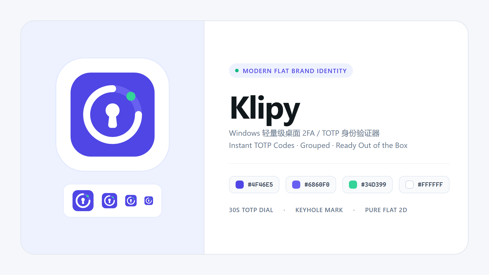

# Klipy

基于 **HeroUI (原 NextUI) + Electron + C# (.NET 10)** 开发的 Windows 轻量级桌面双重认证（2FA / TOTP）身份验证器。

- **命名释义**：**Klipy** 融合 **K**ey（动态密钥）与 C**lip**（单击卡片即刻写入剪贴板），轻快好记、开箱即用。

---

## 🎨 应用 Logo 设计



采用**平面扁平式现代化设计（Modern Flat 2D）**，摒弃冗余光晕、阴影与复杂渐变，以纯粹几何与高对比色块确保在 `20×20` 标题栏到 `512×512` 桌面图标全尺寸下都清晰锐利：

- **靛蓝圆角方形底托（`#4F46E5`）**：与界面 HeroUI 亮色主题主色一脉相承，轮廓简洁现代，在亮色标题栏与 Windows 任务栏下均具备高辨识度；
- **270° TOTP 倒计时环与翠绿时间脉冲点（`#FFFFFF` / `#6860F0` / `#34D399`）**：外圈纯平双色轨道表现 30 秒动态刷新周期，右上角缺口处的翠绿圆点象征实时跳动的时间刻度与核验状态；
- **居中几何钥匙孔（`#FFFFFF`）**：以极简实心几何图形直指安全凭证与身份核验核心，小尺寸下依旧一目了然。

---

## 📸 运行效果截图

### 1. 主界面（验证码卡片；截图可能与当前版本不同）


### 2. 添加账号对话框（手动输入 / otpauth 链接解析）


---

## ✨ 核心特性

1. **现代美观的 HeroUI 设计方案**：
   - 采用 HeroUI (`@heroui/react`) 组件库打造亮色主题（Light Mode，浅灰画布 + 纯白卡片 + 靛蓝主色）。
   - 账号头像使用 [Simple Icons](https://simpleicons.org)（CC0）内置的 85 个常见品牌图标（OpenAI、Anthropic、Muse、Mozilla、Microsoft、GitHub、Slack、微信、QQ 等），先按服务名称、再按账号自动匹配；未识别服务显示名称缩写。素材说明见 `public/brands/SOURCES.md`。
   - 顶部 30 秒线性进度条（`TotpProgress`，Web Animations API 与系统时钟对齐），剩余 10 秒/5 秒时自动变黄/变红；非 30 秒周期账号会在卡片上额外显示独立倒计时角标，并按各自周期刷新验证码。
   - 一键快速复制 TOTP 动态码（单击卡片，写入 Windows 隐私剪贴板），支持鼠标右键或键盘 `Shift+F10` 打开菜单以及 `Alt+↑/↓` 调整排序。

2. **分组管理（账号必须归属分组）**：
   - 标题栏文件夹按钮进入分组管理页，右上角 `+` 弹窗新建分组，分组数量不设上限；支持拖拽与键盘重排，右键或键盘菜单可重命名或删除（删除分组会原子地同时删除组内账号，确认框会标明数量）。
   - 账号列表只按分组展示（只列真实分组，没有「未分组 / 全部」）；有分组时默认落在第一个有账号的分组，分组内排序会合并回全局顺序持久化。
   - 添加账号必须选择分组（默认跟随当前分组），右键「编辑」可随时切换分组；还没有分组时首页会引导先创建分组。

3. **C# 后端核心与单文件原子加密存储**：
   - 采用 C# (`System.Security.Cryptography`) 原生实现 RFC 6238 TOTP 标准协议（SHA1 / SHA256 / SHA512，6 / 8 位，自定义周期）。
   - 内置 Base32 解码引擎、`otpauth://totp/...` 链接解析与导出，支持包含冒号的平台/账号名称往返。
   - 支持 Google Authenticator 迁移链接 `otpauth-migration://offline?data=...` 的单次事务批量导入（链接或二维码均可），自动跳过 HOTP/MD5 及已存在相同密钥的重复条目。
   - 分组与账号统一加密保存于 `%APPDATA%\WindowsAuthenticatorDemo\accounts.json`（`KLIPY-DPAPI-2` Windows DPAPI 当前用户加密 + 临时文件校验原子替换），兼容从旧版明文或 `KLIPY-DPAPI-1` + `groups.json` 自动无缝升级。
   - Electron 主进程与 C# 后端通过 `stdio JSON-RPC` 双向通信：无需占用任何本地 TCP 端口，免除 Windows 防火墙弹窗打扰。

4. **开箱即用，无需密码验证**：
   - 聚焦核心验证功能，无需进入时的密码或密钥验证，启动即可即时查看。
   - 首次启动为空账号库，先创建一个分组即可开始添加账号。

---

## 🛠️ 技术架构

- **前端技术栈**：
  - **框架**：Electron 45 + React 18 + TypeScript + Vite 6
  - **UI 组件库**：HeroUI (`@heroui/react` 2.8)
  - **样式**：Tailwind CSS 3
  - **图标**：Lucide React
- **后端技术栈**：
  - **语言/运行时**：C# (.NET 10)
  - **核心模块**：
    - `TotpEngine.cs`：RFC 6238 动态验证码生成、Base32 编解码、严格 `otpauth://` 解析。
    - `VaultFile.cs` / `VaultStore.cs`：统一 `KLIPY-DPAPI-2` 加密保险库、原子提交、旧版自动迁移与批量去重导入。
    - `Program.cs`：数据目录独占锁与 Stdio JSON-RPC 协议调度服务。

---

## 🚀 启动与运行

### Windows 安装包（推荐）

在 [GitHub Releases](https://github.com/LuoMuQAQ/Klipy/releases) 下载 `Klipy-Setup-<版本>-x64.exe`，双击即可为当前 Windows 用户安装。安装包自带运行时，无需另外安装 Node.js 或 .NET。

**覆盖更新**：退出 Klipy 后，直接运行新版 Setup。安装程序会复用原安装位置和快捷方式，无需先卸载；安装和卸载都不会删除用户数据。当前为手动更新，不会在后台自行下载。可用同一 Release 的 `.sha256` 文件核对下载完整性；无代码签名的安装包可能显示 Windows 发布者提示。

### 从源码运行

首次运行或重新安装依赖后，先执行 `npm ci`、`npm run build:vite` 和 `npm run build:backend`。如果 npm 未运行 Electron 的安装脚本，额外执行 `node node_modules/electron/install.js`。

账号库路径不变：`%APPDATA%\WindowsAuthenticatorDemo\accounts.json`。首次使用新版时，后端会把旧版明文库或 `KLIPY-DPAPI-1` + `groups.json` 自动合并迁移为统一的 `KLIPY-DPAPI-2` Windows DPAPI 当前用户加密文件，校验通过才替换。

- **不要用旧版 Klipy 打开已迁移的数据目录**。若新版报告数据不可读，请保留原文件，不要用空库覆盖。DPAPI 绑定 Windows 用户；换机或更换 Windows 用户前请使用现有导出功能。旧备份、导出的二维码和链接仍包含长期密钥，应妥善保管。
- 应用内的验证码复制、导出链接和 Base32 复制仍可正常粘贴，但不会进入 Windows 剪贴板历史或跨设备同步。当前剪贴板仍可被有权限读取它的本机程序访问。
- 测试请使用临时 `AUTHENTICATOR_DATA_DIR`，不要操作真实数据。构建后可运行 `npm run typecheck`、`npm run test:backend`、`npm run test:security` 和 `npm run test:desktop`。测试脚本使用合成账号和临时数据目录；如需禁止桌面测试写入 Windows 剪贴板，请先设置 `KLIPY_TEST_SKIP_CLIPBOARD=1`。维护者可用 `npm run build:setup` 在 `release/` 生成 Windows x64 Setup。

### 方式一：一键双击启动（最简单）
直接双击项目根目录下的 **`启动.bat`** 即可启动。

### 方式二：命令行启动

```bash
# 启动程序
npm start

# 开发调试模式（支持前端热更新）
npm run dev

# 重新构建 C# 后端
npm run build:backend
```

---

## 📁 目录结构

```
身份验证器/
├── backend/                   # C# 后端核心源码
│   ├── TotpEngine.cs          # RFC 6238 TOTP 算法与 Base32 编解码
│   ├── MigrationParser.cs     # Google Authenticator 迁移链接解析
│   ├── VaultFile.cs           # KLIPY-DPAPI-2 加密、校验、迁移与原子落盘
│   ├── VaultStore.cs          # 统一账号与分组管理、批量去重、排序与导出
│   ├── PrivateClipboard.cs    # Windows 隐私剪贴板写入
│   ├── AppPaths.cs            # 数据目录解析（支持 AUTHENTICATOR_DATA_DIR 覆盖）
│   ├── BackendDispatcher.cs   # 业务分发（账号 / 批量导入 / 分组 / 迁移）
│   ├── Models.cs              # 数据契约与 IPC DTO
│   ├── Program.cs             # 主入口、独占锁与 Stdio JSON-RPC 调度
│   └── AuthenticatorBackend.csproj
├── bin/backend/               # 已编译的 C# 后端输出目录
├── public/
│   ├── logo.svg               # 应用矢量 Logo（唯一源文件）
│   ├── app-icon.png           # 512×512 透明底窗口与任务栏图标
│   └── brands/si/             # 85 个品牌图标（Simple Icons，CC0）与 SOURCES.md
├── src/
│   ├── main/                  # Electron 主进程（main / backend-client / ipc-validation / renderer-security / preload）
│   └── renderer/              # 前端渲染层 (HeroUI + React)
│       ├── components/        # TitleBar / GroupFilterBar / GroupManagementPage / AccountCard / Modals / TotpProgress
│       ├── utils/errors.ts    # IPC 错误文案清洗
│       ├── brandIcons.ts      # Simple Icons 品牌匹配表
│       ├── App.tsx            # 主应用页面、分组筛选、拖拽与键盘交互
│       ├── main.tsx           # 入口与 HeroUIProvider / ToastProvider 配置
│       ├── index.css          # 全局样式与自定义滚动条
│       └── types.ts           # TypeScript 类型定义
├── tests/                     # 后端、安全、桌面与打包冒烟测试
├── electron-builder.json      # Windows x64 NSIS 打包配置
├── package.json               # 项目配置与启动脚本
├── tailwind.config.js         # Tailwind & HeroUI 主题配置
├── vite.config.ts             # Vite 构建配置
└── 启动.bat                   # Windows 一键启动脚本
```
