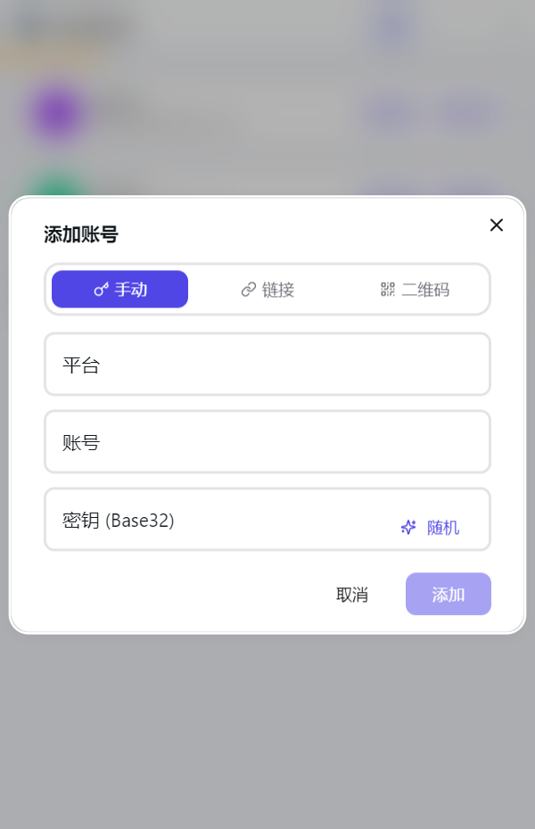

# Klipy

基于 **HeroUI (原 NextUI) + Electron + C# (.NET 10)** 开发的 Windows 轻量级桌面双重认证（2FA / TOTP）身份验证器。

- **命名释义**：**Klipy** 融合 **K**ey（动态密钥）与 C**lip**（单击卡片即刻写入剪贴板），轻快好记、开箱即用。

---

## 🎨 应用 Logo 设计


采用**平面扁平式现代化设计（Modern Flat 2D）**，摒弃冗余光晕、阴影与复杂渐变，以纯粹几何与高对比色块确保在 `20×20` 标题栏到 `512×512` 桌面图标全尺寸下都清晰锐利：

- **靛蓝圆角方形底托（`#4F46E5`）**：与界面 HeroUI 亮色主题主色一脉相承，轮廓简洁现代，在亮色标题栏与 Windows 任务栏下均具备高辨识度；
- **270° TOTP 倒计时环与翠绿时间脉冲点（`#FFFFFF` / `#6860F0` / `#34D399`）**：外圈纯平双色轨道表现 30 秒动态刷新周期，右上角缺口处的翠绿圆点象征实时跳动的时间刻度与核验状态；
- **居中几何钥匙孔（`#FFFFFF`）**：以极简实心几何图形直指安全凭证与身份核验核心，小尺寸下依旧一目了然。

---

## 📸 运行效果截图

### 1. 主界面（动态倒计时环、验证码卡片、搜索）


### 2. 添加账号对话框（手动输入 / otpauth 链接解析）


---

## ✨ 核心特性

1. **现代美观的 HeroUI 设计方案**：
   - 采用 HeroUI (`@heroui/react`) 组件库打造亮色主题（Light Mode，浅灰画布 + 纯白卡片 + 靛蓝主色）。
   - 账号头像使用 [Simple Icons](https://simpleicons.org)（CC0）内置的 85 个常见品牌图标（OpenAI、Anthropic、Muse、Mozilla、Microsoft、GitHub、Slack、微信、QQ 等），先按服务名称、再按账号自动匹配；未识别服务显示名称缩写。素材说明见 `public/brands/SOURCES.md`。
   - 顶部 30 秒线性进度条（`TotpProgress`，Web Animations API 与系统时钟对齐），剩余 10 秒/5 秒时自动变黄/变红，跨周期自动刷新验证码。
   - 一键快速复制 TOTP 动态码（单击卡片），并带有 Toast 与变绿反馈。

2. **分组管理（账号必须归属分组）**：
   - 标题栏文件夹按钮进入分组管理页，可新建、重命名、删除分组；删除分组会同时删除组内账号（确认框会标明数量）。
   - 账号列表只按分组展示（只列真实分组，没有「未分组 / 全部」）；有分组时默认落在第一个有账号的分组，分组内拖拽排序会合并回全局顺序持久化。
   - 添加账号必须选择分组（默认跟随当前分组），右键「编辑」可随时切换分组；还没有分组时首页会引导先创建分组。

2. **高性能 C# 后端核心**：
   - 采用 C# (`System.Security.Cryptography`) 原生实现 RFC 6238 TOTP 标准协议。
   - 内置 Base32 解码引擎（支持自动过滤空格与连字符、不区分大小写）。
   - 内置 `otpauth://totp/...` 协议解析器，支持一键导入主流平台二维码链接。
   - 支持 Google Authenticator 迁移链接 `otpauth-migration://offline?data=...` 的批量导入（链接或二维码均可），HOTP / 不兼容条目自动跳过。
   - 账号自动持久化至 `%APPDATA%\WindowsAuthenticatorDemo\accounts.json`，分组保存在同目录 `groups.json`。
   - Electron 主进程与 C# 后端通过高效的 `stdio JSON-RPC` 双向通信：无需占用任何本地 TCP 端口，免除 Windows 防火墙弹窗打扰，随主程序生命周期自动安全启动与回收。

3. **开箱即用，无需密码验证**：
   - 按要求只做核心验证功能，无需进入时的密码或密钥验证，启动即可即时查看。
   - 首次启动为空账号库，先创建一个分组即可开始添加账号。

---

## 🛠️ 技术架构

- **前端技术栈**：
  - **框架**：Electron 33 + React 18 + TypeScript + Vite 6
  - **UI 组件库**：HeroUI (`@heroui/react` 2.8)
  - **样式**：Tailwind CSS 3
  - **图标**：Lucide React
- **后端技术栈**：
  - **语言/运行时**：C# (.NET 10)
  - **核心模块**：
    - `TotpEngine.cs`：RFC 6238 动态验证码生成、Base32 解码、时间步截断。
    - `AccountStore.cs`：账号管理与 JSON 本地持久化存储。
    - `Program.cs`：Stdio JSON-RPC 协议调度服务。

---

## 🚀 启动与运行

首次运行或重新安装依赖后，先执行 `npm ci`、`npm run build:vite` 和 `npm run build:backend`。如果 npm 未运行 Electron 的安装脚本，额外执行 `node node_modules/electron/install.js`。

应用继续使用 `%APPDATA%\WindowsAuthenticatorDemo\accounts.json`，分组数据在同目录 `groups.json`。`host/` 中的 WebView2 迁移源码仅作备份，不参与 Electron 构建或启动。

### 方式一：一键双击启动（最简单）
直接双击项目根目录下的 **`启动.bat`** 即可启动。

需要把账号分组管理时，点击标题栏的文件夹按钮进入 **分组管理**：新建 / 重命名 / 删除分组，删除分组会同时删除组内账号。回到账号列表后，顶部筛选栏只按分组查看，添加账号时必须选择分组（默认当前分组）。

### 方式二：命令行启动

```bash
# 启动程序
npm start
```

### 开发调试模式（支持前端热更新）：

```bash
npm run dev
```

### 重新构建 C# 后端：

```bash
npm run build:backend
```

---

## 📁 目录结构

```
身份验证器/
├── backend/                   # C# 后端核心源码
│   ├── TotpEngine.cs          # RFC 6238 TOTP 算法与 Base32 编解码
│   ├── MigrationParser.cs     # Google Authenticator 迁移链接解析
│   ├── AccountStore.cs        # 账号本地持久化、排序与导出
│   ├── GroupStore.cs          # 分组管理（groups.json）
│   ├── AppPaths.cs            # 数据目录解析（支持 AUTHENTICATOR_DATA_DIR 覆盖）
│   ├── BackendDispatcher.cs   # 业务分发（账号 / 分组 / 迁移）
│   ├── Models.cs              # 数据契约与 IPC DTO
│   ├── Program.cs             # 主入口与 Stdio JSON-RPC 调度
│   └── AuthenticatorBackend.csproj
├── bin/backend/               # 已编译的 C# 独立执行程序
│   └── AuthenticatorBackend.exe
├── public/
│   └── brands/si/             # 85 个品牌图标（Simple Icons，CC0）与 SOURCES.md
├── src/
│   ├── main/                  # Electron 主进程
│   │   ├── main.js            # 窗口生命周期与 C# 后端进程守护
│   │   └── preload.js         # 安全 ContextBridge API 注入
│   └── renderer/              # 前端渲染层 (HeroUI + React)
│       ├── components/
│       │   ├── TitleBar.tsx           # 标题栏（添加 / 分组管理 / 窗口控制）
│       │   ├── GroupFilterBar.tsx     # 分组筛选栏
│       │   ├── GroupManagementPage.tsx# 分组管理页
│       │   ├── AccountCard.tsx        # TOTP 验证卡片
│       │   ├── AddAccountModal.tsx    # 添加账号（手动 / 链接 / 二维码 / 迁移）
│       │   ├── EditAccountModal.tsx   # 编辑账号（名称 / 账号 / 分组）
│       │   └── DeleteConfirmModal.tsx # 删除确认弹窗
│       ├── utils/errors.ts    # IPC 错误文案清洗
│       ├── brandIcons.ts      # Simple Icons 品牌匹配表
│       ├── App.tsx            # 主应用页面与分组筛选
│       ├── main.tsx           # 入口与 HeroUIProvider 配置
│       ├── index.css          # 全局样式与自定义滚动条
│       └── types.ts           # TypeScript 类型定义
├── package.json               # 项目配置与启动脚本
├── tailwind.config.js         # Tailwind & HeroUI 主题配置
├── vite.config.ts             # Vite 构建配置
└── 启动.bat                   # Windows 一键启动脚本
```
